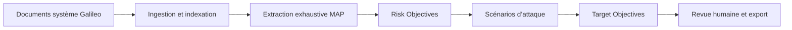

# AI for Galileo — analyse documentaire et méthode SRA souveraines

AI for Galileo est un espace de travail local pour exploiter un corpus système
Galileo et produire une analyse de risques **traçable jusqu’aux documents
sources**. L’application combine un chat documentaire multi-source avec une
verticale métier SRA qui construit et révise les Risk Objectives, Target
Objectives et scénarios associés.

Le RAG n’est pas ici une démonstration générique : il fournit le socle de preuve
du workflow SRA. Chaque résultat métier conserve ses sources, sa couverture et
sa trace de traitement afin de rester révisable par un analyste.

## Deux surfaces, un même corpus

| Surface | Usage |
|---|---|
| Chat documentaire | Recherche sourcée, questions multi-documents, modes RAG, Agent, Auto et Analyse profonde |
| Méthode SRA | Dossiers, RO Types, scénarios d’attaque, Target Objectives, revue et exports |

Le chat répond aux questions ouvertes. La méthode SRA transforme les preuves du
corpus en livrables structurés, éditables et persistés.

## Workflow SRA



- Taxonomie de RO Types configurable et classification des objectifs.
- Extraction multi-documentaire avec budget élastique et couverture mesurée.
- Enrichissement des scénarios et association explicite aux cibles techniques.
- Corpus `docs/PDF_TO/` dédié à la preuve des Target Objectives.
- Persistance des brouillons, révisions manuelles et traces de génération.
- Exports structurés CSV/XLSX.

## Garanties de preuve

- Retrieval hybride : embeddings + BM25, fusion RRF et reranking local.
- Citations attachées aux affirmations et aux objets SRA.
- Registre de preuves et contrat de réponse contre les conclusions non soutenues.
- Contrôles de couverture, qualité des chunks et cohérence des index.
- Streaming SSE de la stratégie, de la progression et des résultats.
- Exécution 100 % locale avec Ollama, MongoDB et Chroma.

## Architecture

- `core/sra/` : génération, classification, enrichissement, traitement et exports.
- `api/sra.py` : dossiers SRA, génération streamée, édition et téléchargement.
- `web/src/components/sra/` : atelier SRA.
- `core/answer_contract.py`, `core/evidence_*` : preuve et validation.
- `core/synthesize_corpus.py` : analyse exhaustive multi-documentaire.
- `retrieval/` et `indexing/` : recherche hybride et stockage local.
- `docs/PDF_TO/` : corpus architectural des cibles techniques.

Voir [`ARCHITECTURE.md`](ARCHITECTURE.md) et
[`docs/PROJECT_STATE.md`](docs/PROJECT_STATE.md).

## Démarrage rapide

Prérequis : Python 3.12, Node.js 20+, MongoDB et Ollama.

```bash
python -m venv .venv
source .venv/bin/activate
pip install -r requirements.txt
python -m spacy download fr_core_news_sm
ollama pull mistral-small3.2
ollama pull bge-m3
cp .env.example .env
python serve.py
```

Interface : <http://localhost:3001>. API : <http://localhost:8001>. Les ports
sont configurables dans `.env`.

Pour une installation isolée, utiliser `deploy/offline.sh prepare DESTINATION`
et suivre
[`docs/INSTALLATION_HORS_LIGNE.md`](docs/INSTALLATION_HORS_LIGNE.md).

## Vérification

```bash
python -m pytest
python -m evals.run_eval --mode retrieval
cd web && npm run lint && npm run build
```

## Limites

- PoC mono-poste : authentification, autorisations et multi-tenant restent hors
  périmètre.
- Les livrables SRA sont des propositions assistées qui exigent une revue
  humaine avant usage opérationnel.
- La qualité dépend de la complétude des documents et de la capacité du modèle
  local ; les indicateurs de couverture doivent accompagner l’analyse.

## Documentation

- [`ARCHITECTURE.md`](ARCHITECTURE.md) — architecture et flux SRA/RAG.
- [`docs/PROJECT_STATE.md`](docs/PROJECT_STATE.md) — état canonique et validations.
- [`docs/CODEX-ROADMAP.md`](docs/CODEX-ROADMAP.md) — feuille de route active.
- [`docs/INSTALLATION_HORS_LIGNE.md`](docs/INSTALLATION_HORS_LIGNE.md) — livraison air-gap.
