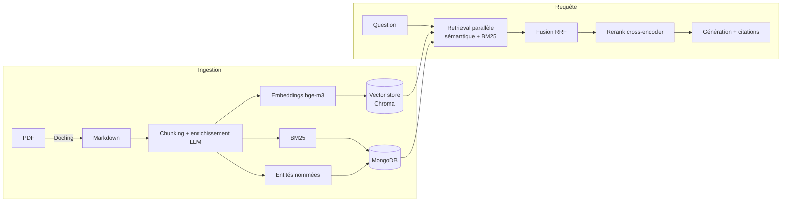

# AI for SSH — suite souveraine pour l'ingénierie de sécurité (PoC)

**AI for SSH** est une **application 100 % locale** (aucune API externe) de
questions/réponses **sourcées** sur des cibles de sécurité (ANSSI / Critères
Communs) : retrieval hybride, agent ReAct, serveur MCP, observabilité,
**évaluation chiffrée**. L'interface est un **front Next.js + API FastAPI**
(`python serve.py`). Pile locale : Ollama (routage multi-modèles + `bge-m3`) et
MongoDB, thème sombre.

> **Ce que c'est** : une implémentation de référence **réutilisable et multi-OS** qui
> couvre l'essentiel de la feuille de route « AI Engineer » (RAG → agents → prod), avec
> une discipline *mesure-avant-d'optimiser*. **Ce que ce n'est pas** : une plateforme
> déployée à l'échelle. C'est un PoC abouti, pas un service en production (voir
> [Limites assumées](#limites-assumées)).

---

## Pourquoi ce projet se distingue

La plupart des projets RAG s'arrêtent à « LangChain + une base vectorielle ». Ici, chaque
brique est **activable**, **mesurée**, et **retirée quand la donnée ne la justifie pas** :

- **Retrieval hybride** sémantique + BM25 + reranking cross-encoder, fusionnés par RRF,
  avec option parent-child.
- **Évaluation intégrée** (golden set + métriques type RAGAS) → décisions pilotées par la
  donnée, y compris des **suppressions** (voir plus bas).
- **Observabilité** (traces/spans souverains) qui a réellement servi à diagnostiquer (ex.
  « la génération = ~85 % de la latence »).
- **Agentique** : RAG-comme-outil, **serveur MCP**, **agent ReAct** streamé.
- **Adaptatif** : modes Auto, RAG, Agent et **Analyse profonde**, synthèse MAP/REDUCE et routage des modèles par rôle.
- **Pilotable** : métriques et couverture dans le Chat; onglet Agents pour versionner les prompts et les comparer sur golden set.
- **Souveraineté** : tout tourne en local (Ollama + modèles auto-hébergés), zéro donnée
  envoyée à un tiers.

## Résultats mesurés — repère historique ANSSI

**Qualité du retrieval** (golden set v2 de 30 Q/R ancrées dans le document,
`python -m evals.run_eval --mode retrieval` ; dernier run archivé dans
[`evals/last_eval.json`](evals/last_eval.json)) :

| Métrique | Valeur |
|---|---|
| hit@k (mots-clés attendus) | **0.64** |
| context recall | **0.53** |
| context precision | 0.29 |

→ Ce run reste un repère historique ANSSI. Les campagnes contemporaines multi-documentaires et RAGAS sont décrites dans `docs/PROJECT_STATE.md`; elles ne doivent pas être comparées directement à ce dataset. La valeur du projet tient à la **démarche mesurée** (harnais
d'éval reproductible + observabilité) qui rend ce diagnostic possible et non à un score
brut. Les chiffres sont reproductibles ; ils ne sont pas figés dans le marbre.

**Décisions pilotées par la mesure (ce qui a été retiré).** Le harnais a servi à
*désactiver et supprimer* ce qui n'apportait rien sur ce corpus, pas seulement à ajouter :

- **GraphRAG** : effet nul mesuré (deux fois) → **retiré entièrement** (builder + retriever
  graphe, vue, toggles, config). Seule l'extraction d'entités (NER) reste, comme
  enrichissement des chunks.
- **Réécriture de requête LLM** : effet négatif + latence → **retirée** ; un simple
  *trim* qui préserve les acronymes *verbatim* fait mieux (`nlp/query_rewriter.py`).
- **Second backend vectoriel (Qdrant)** : jamais utilisé → **retiré** (dépendance
  `qdrant-client` incluse). L'abstraction `VectorStore` reste (point d'extension), avec un
  seul backend embarqué : **Chroma**.

Résultat cumulé de ce ménage : **~-12 % de lignes**, non-régression du retrieval vérifiée.

**Latence** (diagnostiquée via les traces) : la **génération domine (~85 %)** du temps sur
GPU contraint (un modèle 8B + grand contexte déborde la VRAM → offload CPU). Leviers livrés :
- *Mode rapide* (modèle plus léger + prompt épuré) : nettement plus court.
- *Agent retrieve-only* (1 seule génération finale au lieu d'une par recherche).
- *Streaming* : première pensée affichée en quelques secondes (ressenti type assistant
  conversationnel).

## Stack & techniques

| Domaine | Ce qui est implémenté |
|---|---|
| Embeddings / Vector DB / RAG | retrieval hybride + RRF + rerank cross-encoder, RAPTOR, parent-child, abstraction `VectorStore` (backend Chroma), évaluation chiffrée |
| Agents / MCP / Observabilité | tracing/spans, anti-injection, RAG-comme-outil, **serveur MCP**, **agent ReAct** streamé |
| Prompt engineering | ancrage + citations, auto-correction (ex-Self-RAG), prompts détaillé/épuré |
| Modèles | auto-hébergé (Ollama), **routage de modèles** par rôle |

## Architecture

Carte de lecture complète (couches, points d'entrée, flux) :
**[ARCHITECTURE.md](ARCHITECTURE.md)**.
État courant, validations et reprise : **[docs/PROJECT_STATE.md](docs/PROJECT_STATE.md)**.



Couches agentiques au-dessus : `tools/rag_tool.py` (RAG-comme-outil) → `rag_mcp_server.py`
(MCP) → `core/agent.py` (ReAct streamé). Observabilité : `utils/tracing.py`.

## Démarrage rapide

```bash
# 1. Récupérer le code (USB) puis se placer à la racine du projet
python -m venv .venv && source .venv/bin/activate   # Windows : .venv\Scripts\Activate.ps1
pip install -r requirements.txt                      # RAG + dev ; + requirements-gpu.txt si GPU NVIDIA
python -m spacy download fr_core_news_sm
ollama pull mistral-small3.2 && ollama pull bge-m3
cp .env.example .env
python serve.py            # démarre MongoDB + Ollama + le front Next.js + l'API FastAPI
```

Guide complet (modèles, GPU, gotchas par OS, **install hors-ligne / réseau
restreint**) : **[SETUP_PORTABLE.md](SETUP_PORTABLE.md)**.
Prérequis runtime : **Ollama** + **MongoDB**.

Livraison air-gap complète : `deploy/offline.sh prepare DESTINATION`.
Installation et exploitation : **[docs/INSTALLATION_HORS_LIGNE.md](docs/INSTALLATION_HORS_LIGNE.md)**.

## Points d'entrée

| Commande | Rôle |
|---|---|
| `python serve.py` | UI cible : API FastAPI (`:8001`) + front Next.js (`:3001`) |
| `python -m evals.run_eval --mode retrieval` | évaluation chiffrée (retrieval) |
| `python -m core.agent "…"` | agent ReAct en CLI |
| `python rag_mcp_server.py` | serveur MCP (stdio) |
| `python diagnostic.py` | état des services + routage + vector store |
| `python -m pytest` | tests unitaires (fonctions pures, hors-ligne) |

## Structure

```text
api/         backend FastAPI : rag, sessions, documents, system
web/         front Next.js 16
core/        orchestration (ask, ingest, llm_answer, agent, planner, model_router, self_rag)
retrieval/   retrieval hybride, fusion RRF, rerank, vector_store (abstraction Chroma)
indexing/    chunking, embeddings, BM25, persistance Mongo
nlp/         trim de requête, NER, enrichissement de chunks
evals/       harnais d'évaluation + golden set
utils/       tracing, sécurité, logging
env_config.py  config portable centralisée
```

## Limites assumées

C'est un **PoC de référence**, à prendre comme tel :

- **Corpus de démonstration** : le multi-document, la couverture par document et la synthèse MAP/REDUCE sont opérationnels sur le corpus spatial courant. La généralisation à des corpus beaucoup plus volumineux reste à mesurer.
- **Qualité à consolider** : les runs RAG et Agent sont disponibles, mais les campagnes Auto et Analyse profonde sur un golden set spatial stabilisé restent à exécuter.
- **Génération** : le LLM local est le maillon faible en qualité (français parfois
  imparfait) ; l'exactitude prime sur la vitesse pour des docs de sécurité.
- **Latence** : élevée sur petit GPU (offload CPU). Le vrai correctif est l'infra (GPU
  dédié ou modèle hébergé) ; le code (routage, streaming, abstractions) y est déjà prêt.
- **Mono-poste souverain** : conteneur / auth / multi-tenant restent hors périmètre
  du PoC.

## Licence / contexte

Projet personnel d'apprentissage (AI Engineer). Documents ANSSI publics.
